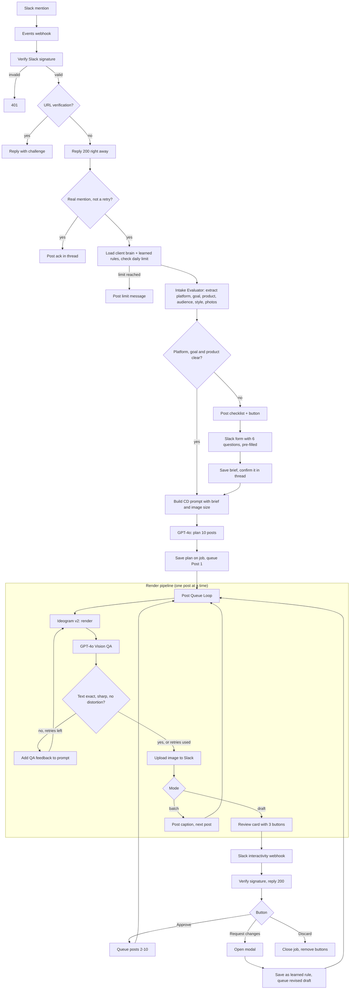

# System architecture

Everything below exists in `slack-design-agent-2stage-workflow.json`.

## Job memory
Stored in n8n workflow static data (works while the workflow is active):
- `jobs[job_id]`: client, Slack channel and thread, confirmed brief, campaign plan, status (`intake`, `awaiting_intake`, `planning`, `drafting`, `awaiting_review`, `revising`, `generating`, `complete`, `discarded`), QA warning count.
- `learned[client_id]`: rules created from "Request changes" notes (last 20).
- `usage[client_id][date]`: images rendered per day.

## Why one pipeline for draft and batch
Stage 1 sends Post 1 and stage 2 sends Posts 2 to 10 into the same loop. QA, retries, uploads and delivery are written once.

## Cost levers
- Draft first: 1 plan call + 1 image + 1 QA call before a human approves.
- Retries are capped at 2 per image.
- Daily image limit per client.
